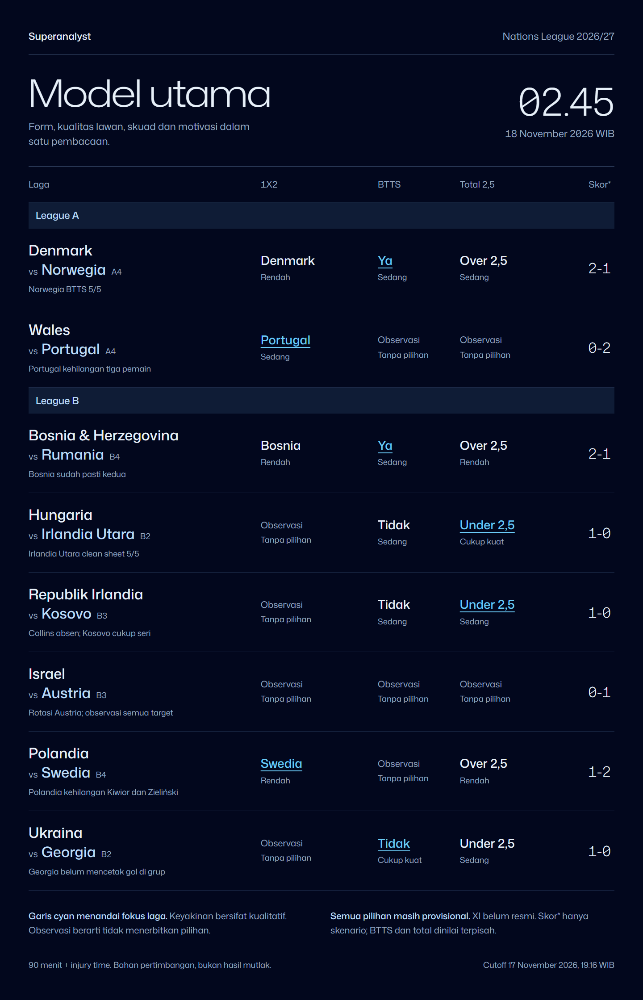
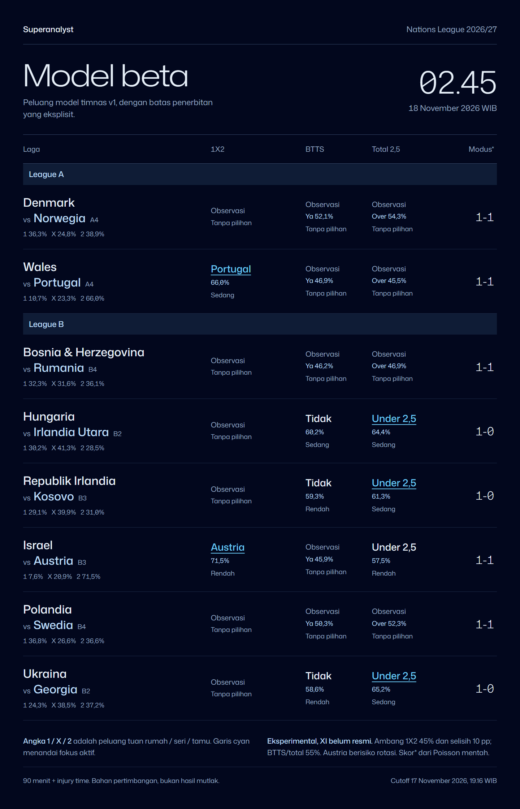

# Hasil analisis UNL, 18 November 2026

Analisis prapertandingan delapan laga UEFA Nations League dengan kickoff 18 November 2026 pukul 02.45 WIB. Memuat **model utama kualitatif UNL v1** dan **model beta riset timnas v1**, beserta dua poster Hallmark bertema gelap.

Batas informasi: **17 November 2026, 19.16.25 WIB**. Laporan dan gambar asli disalin tanpa perubahan. Unggahan GitHub dilakukan pada 18 November 2026; waktu unggahan ini berbeda dari waktu pembuatan analisis sebelum pertandingan.

## Laporan lengkap

- [Baca analisis lengkap](Superanalyst-UNL-18-November-2026-lengkap.md)
- [Unduh laporan HTML untuk dibuka di browser](Superanalyst-UNL-18-November-2026-lengkap.html)
- [Daftar berkas publik dan checksum](manifest-v1.json)

## Poster model utama

## Poster model beta

**Observasi** berarti belum menerbitkan pilihan aktif. Status XI dan keterbatasan data mengikuti waktu analisis asli. Folder ini berisi laporan dan poster; jurnal, snapshot mentah dan paket model tetap disimpan lokal.

Model beta masih eksperimental. Analisis menjadi bahan pertimbangan, bukan hasil mutlak.
